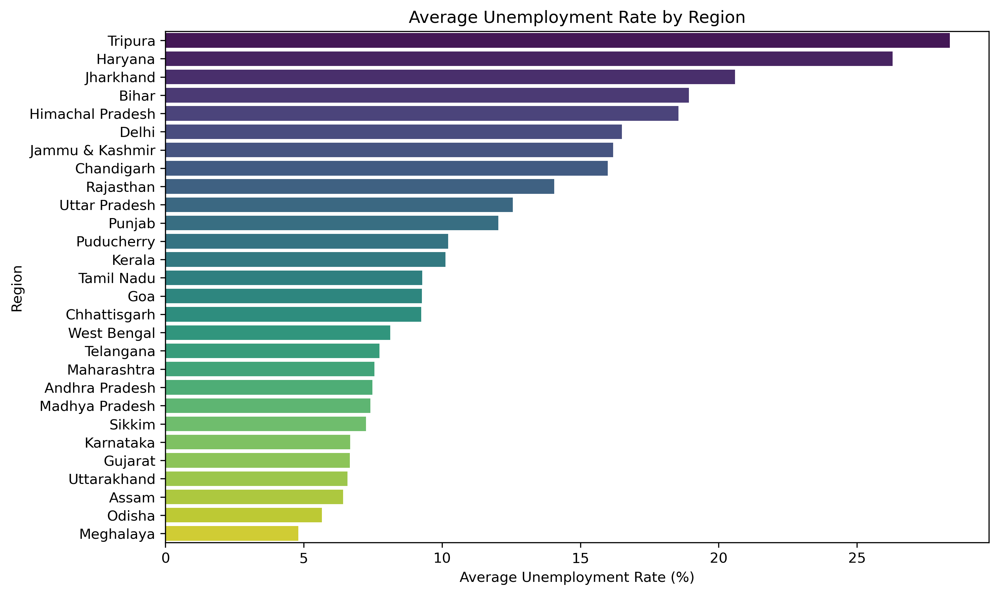
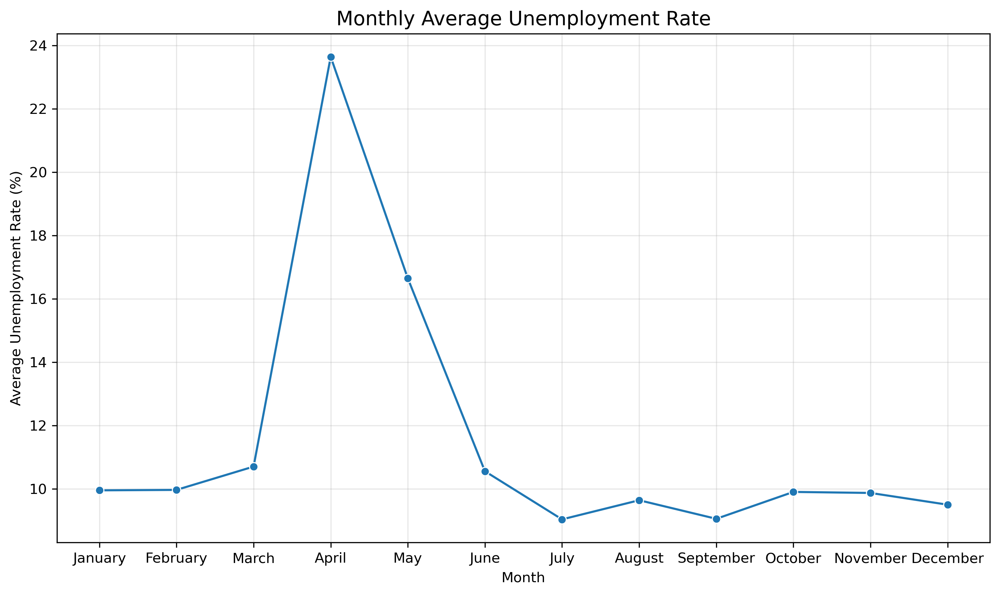
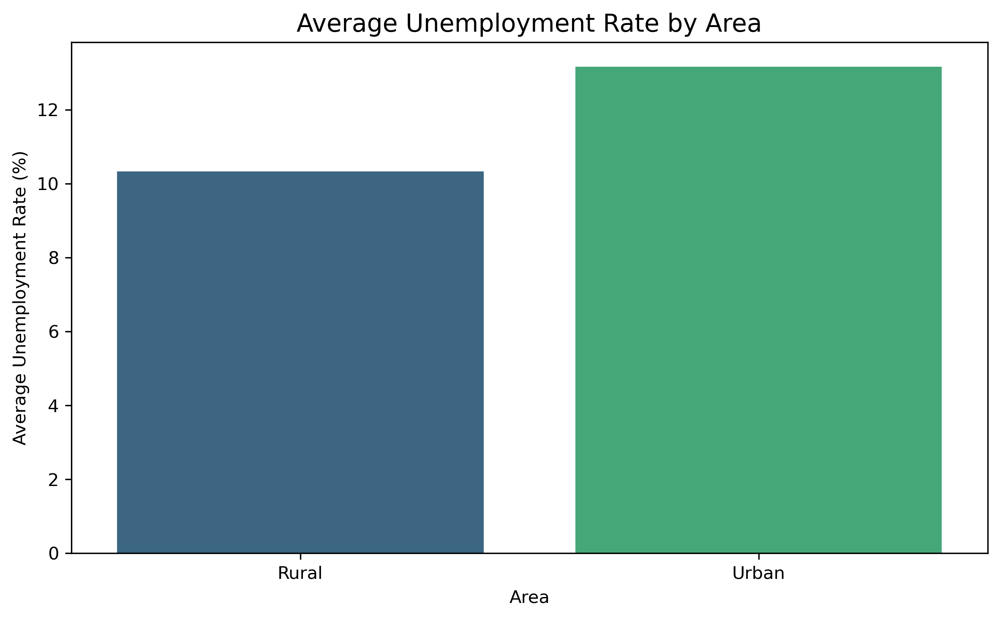
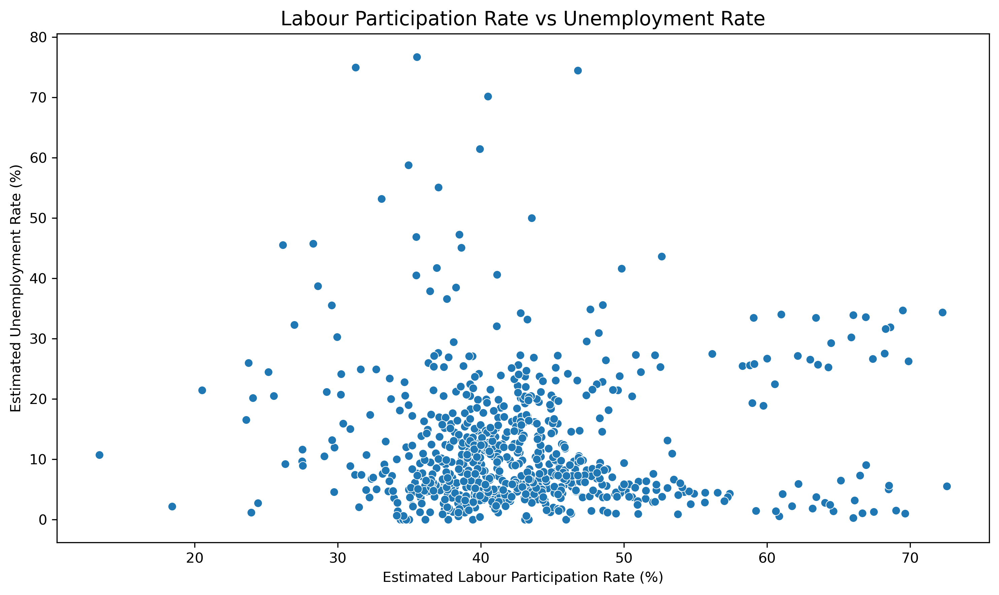

# 🇮🇳 Unemployment Analysis in India

## 📌 Project Overview

This project performs **Exploratory Data Analysis (EDA)** on unemployment data from different regions of India using Python. The objective is to understand regional unemployment patterns, employment distribution, labour participation rates, and monthly unemployment trends through statistical analysis and data visualization.

The project demonstrates the complete data analysis workflow, including data understanding, data cleaning, feature engineering, exploratory data analysis, and correlation analysis.

---

## 🎯 Objectives

- Understand the structure of the unemployment dataset
- Clean and preprocess the dataset
- Analyze unemployment rates across different regions
- Compare estimated employment among regions
- Analyze labour participation rates
- Compare Urban and Rural unemployment
- Study monthly unemployment trends
- Explore the relationship between labour participation rate and unemployment rate

---

## 🔄 Project Workflow

1. Load the dataset
2. Understand the dataset
3. Clean the data
4. Perform feature engineering
5. Conduct exploratory data analysis
6. Visualize important trends
7. Analyze correlations
8. Summarize findings

---

## 🛠️ Technologies Used

| Category | Tools |
|---|---|
| Language | Python |
| Data Handling | Pandas, NumPy |
| Visualization | Matplotlib, Seaborn |
| Environment | Jupyter Notebook |

---

## 📂 Project Structure
unemployment-analysis-india/
│
├── data/
│ ├── Unemployment in India.csv
│ └── cleaned_data_unemployment_in_india.csv
│
├── images/
│ └── (visualization outputs)
│
├── notebook/
│ └── unemployment_analysis.ipynb
│
├── requirements.txt
├── .gitignore
└── README.md

---

## 📊 Analysis Performed

The project includes the following analyses:

1. Data Understanding
2. Data Cleaning
3. Feature Engineering
4. Average Unemployment Rate by Region
5. Average Estimated Employment by Region
6. Labour Participation Rate by Region
7. Urban vs Rural Unemployment Comparison
8. Monthly Unemployment Trend Analysis
9. Correlation Analysis

---

## 🔑 Key Findings

- **Tripura** recorded the highest average unemployment rate, while **Meghalaya** recorded the lowest
- **Uttar Pradesh** had the highest average estimated employment
- **Tripura** showed the highest average labour participation rate
- **Urban areas** experienced higher average unemployment than **Rural areas**
- **April** recorded the highest average unemployment, while **July** recorded the lowest
- The correlation coefficient (≈ 0.003) indicates almost no linear relationship between labour participation rate and unemployment rate

---

## 📊 Sample Visualizations

### Average Unemployment Rate by Region

### Monthly Unemployment Trend

### Urban vs Rural Unemployment

### Correlation — Labour Participation vs Unemployment

---

## 🧠 Skills Demonstrated

- Data Cleaning
- Data Preprocessing
- Feature Engineering
- Exploratory Data Analysis (EDA)
- Data Visualization
- Statistical Analysis
- Correlation Analysis
- Python Programming
- Pandas · NumPy · Matplotlib · Seaborn

---

## 🚀 Future Improvements

- Build machine learning models to predict unemployment rates
- Time-series forecasting of unemployment
- Interactive dashboards using Streamlit or Power BI
- Geographical visualization using location-based datasets

---

## 📬 Contact

**Nadeem Ahmed Ghoto**
BS Artificial Intelligence Student | Aspiring AI/ML Engineer

- GitHub: [@NADEEMAHMED770](https://github.com/NADEEMAHMED770)
- LinkedIn: [Nadeem Ahmed](https://www.linkedin.com/in/nadeem-ahmed-15033a328/)
- Kaggle: [nadeemahmedghoto](https://www.kaggle.com/nadeemahmedghoto)